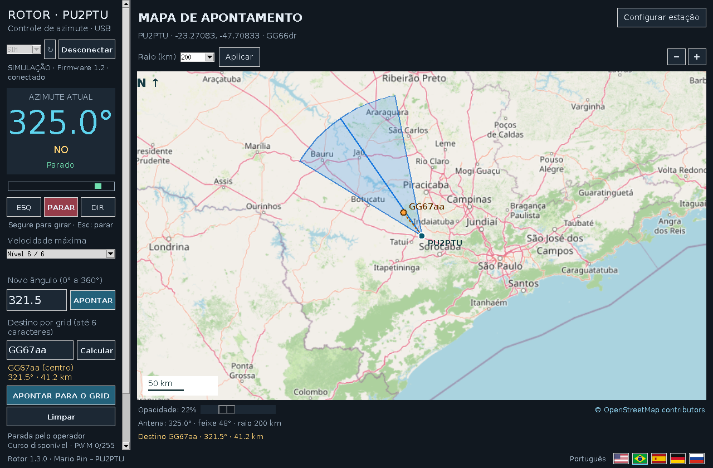
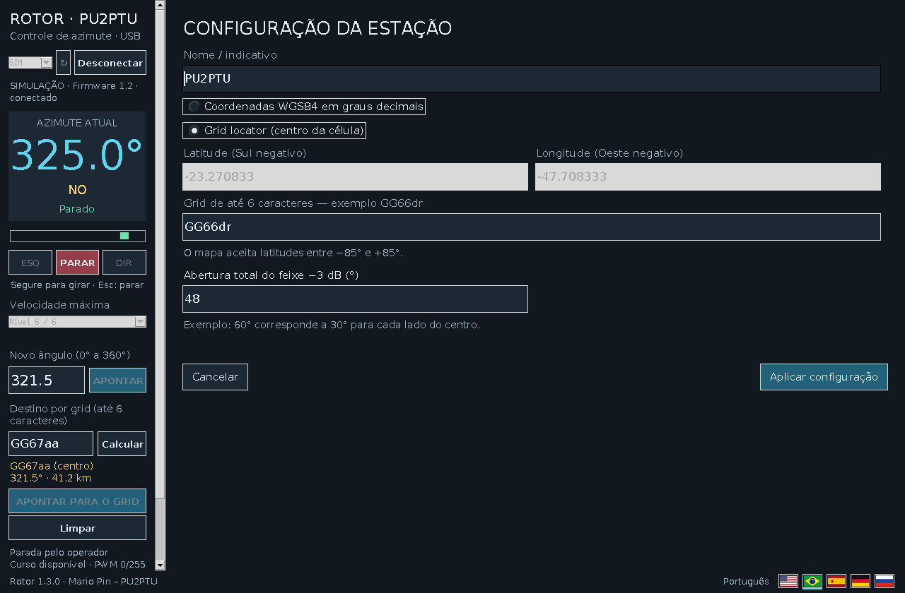

# Rotor PU2PTU

**English** | [Português (Brasil)](README.pt-BR.md)

An antenna rotor controller with **Arduino Uno firmware** and a **Windows control and map application**. It reads an analog position sensor, drives a DC motor through a BTS7960/IBT-2 bridge and offers local buttons as well as USB serial control.

**Author:** Mario Pin, PU2PTU · **Windows application:** 1.3.0 · **Arduino firmware:** 1.2

## Features

- Live azimuth, mechanical position, end-limit indication, manual left/stop/right controls and automatic pointing to an angle.
- Pointing to a Maidenhead grid locator (2, 4 or 6 characters) using station coordinates and WGS84 geodesics.
- OpenStreetMap station-centered map, adjustable radius and opacity, and a directional cone showing the configured **total −3 dB beamwidth**. The cone is an orientation graphic, not a radio coverage prediction.
- Six maximum PWM levels, saved in the Arduino EEPROM and adjustable from Windows or the two physical buttons.
- Smooth acceleration/deceleration, electronic travel limits, sensor/stall/time faults, physical-button priority, local configuration lockout and stop on loss of remote contact.
- English, Portuguese, Spanish, German and Russian interface; a Windows simulation mode works without the Arduino.

## Hardware and wiring

Use an **Arduino Uno**, a **240 × 240 ST7789 SPI TFT**, **two normally open pushbuttons**, an analog position sensor/potentiometer, a **BTS7960/IBT-2** motor driver and a DC rotor motor with its appropriately rated **12/24 V motor supply**. The Windows **STOP** control is on screen: this firmware has **two physical buttons**, LEFT and RIGHT. A common ground is required between the Uno and the driver's logic side; connect the motor power supply to the driver's power terminals, **not to an Uno I/O pin**. Match motor voltage, current, wiring and protection to the actual hardware.

| Device / signal | Arduino Uno | Connection or purpose |
| --- | --- | --- |
| LEFT button | D2 | Other contact to GND; internal `INPUT_PULLUP` |
| RIGHT button | D4 | Other contact to GND; internal `INPUT_PULLUP` |
| Position sensor wiper | A0 | Analog feedback; sensor reference to 5 V and GND |
| BTS7960 `RPWM` | D3 | Motor direction PWM |
| BTS7960 `LPWM` | D5 | Opposite direction PWM |
| BTS7960 `R_EN`, `L_EN` | 5 V | Enabled in the documented assembly |
| BTS7960 logic GND | GND | Common ground with Uno |
| TFT `CS` | D10 | SPI chip select |
| TFT `DC` / `A0` | D9 | Data/command |
| TFT `RST` / `RES` | D8 | Reset |
| TFT `SDA` / `DIN` / `MOSI` | D11 | Hardware SPI data |
| TFT `SCL` / `SCK` / `CLK` | D13 | Hardware SPI clock |
| TFT `GND`, `VCC`, `BL` | GND and module-appropriate supply | Backlight and supply depend on the display board |

The TFT's `SDA`/`SCL` labels refer to **SPI**, not Uno I²C pins A4/A5. Uno digital outputs are 5 V; use an ST7789 module that accepts the selected supply and logic levels or add the required 3.3 V supply/level conversion. Do not assume all ST7789 modules accept 5 V.

**Calibration:** the supplied firmware uses `VREF = 5.00 V`, with **4.80 V = first north (0°)** and **0.40 V = second north (360°)**. Turning right lowers sensor voltage and increases mechanical angle. Right travel is blocked at or below **0.30 V**; left travel at or above **4.90 V**. Check the sensor's output range and direction before connecting motor power. Recalibration requires editing the constants in the sketch. See the [firmware guide](Arduino/GUIA_FIRMWARE_1.2.md) for fault thresholds and a staged first test.

## Software and libraries

| Component | Requirements |
| --- | --- |
| Ready-to-use Windows installer | Windows 10/11 x64; installer bundles Python and application libraries. |
| Windows source | Python 3.11/3.12 with Tcl/Tk; `pyserial==3.5`, `Pillow>=11,<13`, `geographiclib==2.1` from [`Windows/requirements.txt`](Windows/requirements.txt). |
| Arduino sketch | Arduino IDE, Arduino Uno AVR core, **Adafruit GFX Library**, **Adafruit ST7735 and ST7789 Library**, and **Adafruit BusIO** dependency. `SPI` and `EEPROM` are supplied by the AVR environment. |

1. Download the current installer from [Releases](https://github.com/mariopin80/Antenna-Rotor-PU2PTU/releases) and install it on Windows, or run `Windows/INSTALAR.bat` followed by `Windows/INICIAR.bat` from a source checkout.
2. Open [`rotor_1_2.ino`](Arduino/rotor_1_2/rotor_1_2.ino), select **Arduino Uno** and its port, then compile and upload. **Windows 1.3.0 needs firmware 1.2 and serial protocol 2**; installing the desktop app does not flash the Uno.
3. Close the Arduino Serial Monitor, connect the Uno by USB, select its COM port in the Windows app and wait for identification and the saved speed level.

To explore the interface without hardware, launch the installed **Rotor PU2PTU - Simulacao** shortcut or run `Windows/SIMULAR.bat`. Map tiles for new areas need internet; USB control and grid calculations do not.

## Using the controller

1. Select **English** with the language flags if needed. Open **Configure station** above the map. Enter station name/callsign and WGS84 coordinates (south/west negative), or a Maidenhead grid. Set the **full −3 dB beamwidth**: for example, 60° draws ±30° about the pointing axis.
2. Set the map radius and the maximum speed. In simulation, practice LEFT/STOP/RIGHT, direct angle pointing and grid lookup before operating a motor.
3. In live mode, hold **LEFT** or **RIGHT** for manual motion and release to stop; use **STOP** or Esc to cancel. Enter 0–360° and select **POINT**, or enter a destination grid, calculate its azimuth/distance and then point to it.
4. From the physical controller, hold LEFT or RIGHT to move. Pressing **both** while moving stops immediately. With the rotor already stopped, hold both for about **2 seconds**, release, select a maximum speed with LEFT/RIGHT and press both to save.

| Speed level | Maximum PWM / 255 |
| ---: | ---: |
| 1 | 70 |
| 2 | 90 |
| 3 | 110 |
| 4 | 140 |
| 5 | 175 |
| 6 | 220 |

These are PWM ceilings, **not measured angular speeds**. The Arduino retains the selected level in EEPROM; Windows reads the actual level upon connection. If the position sensor is invalid or a motion fault is latched, correct the cause before clearing the fault. The local buttons override remote motion. See [the detailed user guide](LEIA_PRIMEIRO.md) and the [USB protocol](PROTOCOLO.md) for commands and telemetry (`115200` baud, protocol 2).

## Project files and notes

- [`Windows/`](Windows/) contains the GUI, translations, map and installer scripts; [`Arduino/`](Arduino/) contains the active sketch and hardware guide.
- [`Testes/`](Testes/) contains automated checks; [`VALIDACAO.md`](VALIDACAO.md) describes their scope. A simulation or automated run does not replace a first low-speed test on the actual rotor.
- The installation stores map/station preferences in `%APPDATA%\RotorPU2PTU\mapa.json`; the speed ceiling is stored on the Arduino.
- Map data: [OpenStreetMap contributors](https://www.openstreetmap.org/copyright). Third-party notices: [`CREDITOS.txt`](Windows/Instalador/CREDITOS.txt).
