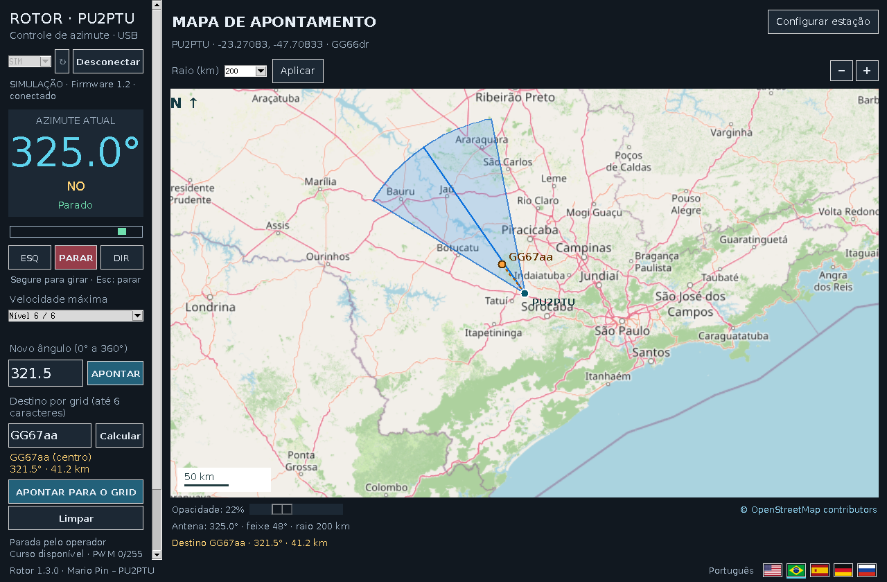
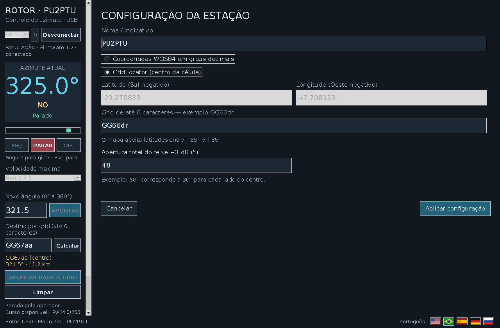

# Rotor PU2PTU

[English](README.md) | **Português (Brasil)**

Controlador de rotor de antena com **firmware para Arduino Uno** e **aplicativo Windows com mapa**. Lê um sensor analógico de posição, aciona o motor CC por um BTS7960/IBT-2 e permite comando local pelos botões ou remoto pela USB.

**Autor:** Mario Pin, PU2PTU · **Aplicativo Windows:** 1.3.0 · **Firmware Arduino:** 1.2

## Recursos

- Azimute e posição mecânica em tempo real, indicação dos limites, comandos ESQ/PARAR/DIR e apontamento automático para um ângulo.
- Apontamento para grid Maidenhead de 2, 4 ou 6 caracteres, calculado a partir da estação por geodésica WGS84.
- Mapa OpenStreetMap centrado na estação, raio e opacidade ajustáveis e cone direcional com a **abertura total de −3 dB** configurada. O cone indica orientação, não prevê cobertura de rádio.
- Seis níveis máximos de PWM, salvos na EEPROM do Uno e ajustáveis pelo Windows ou pelos dois botões físicos.
- Rampas de aceleração/desaceleração, limites eletrônicos, falhas de sensor/travamento/tempo, prioridade dos botões locais e parada por perda do contato remoto.
- Interface em inglês, português, espanhol, alemão e russo; simulação no Windows sem Arduino.

## Montagem e ligações

Use **Arduino Uno**, **TFT ST7789 SPI 240 × 240**, **dois botões normalmente abertos**, sensor de posição/potenciômetro analógico, driver **BTS7960/IBT-2** e motor CC do rotor com **fonte de potência 12/24 V** dimensionada para o conjunto. O botão **PARAR** está na interface Windows: o firmware utiliza **dois botões físicos**, ESQ e DIR. Una o GND do Uno ao GND lógico do driver; a fonte de potência do motor vai aos terminais próprios do BTS7960, **nunca a um pino de E/S do Uno**. Dimensione alimentação, cabos e proteção para o motor real.

| Dispositivo / sinal | Arduino Uno | Ligação ou função |
| --- | --- | --- |
| Botão ESQ | D2 | Outro contato ao GND; `INPUT_PULLUP` interno |
| Botão DIR | D4 | Outro contato ao GND; `INPUT_PULLUP` interno |
| Cursor do sensor | A0 | Retorno analógico; referência do sensor em 5 V e GND |
| BTS7960 `RPWM` | D3 | PWM de um sentido |
| BTS7960 `LPWM` | D5 | PWM do outro sentido |
| BTS7960 `R_EN`, `L_EN` | 5 V | Habilitados na montagem documentada |
| GND lógico do BTS7960 | GND | Terra comum com o Uno |
| TFT `CS` | D10 | Seleção SPI |
| TFT `DC` / `A0` | D9 | Dados/comando |
| TFT `RST` / `RES` | D8 | Reset |
| TFT `SDA` / `DIN` / `MOSI` | D11 | Dados SPI de hardware |
| TFT `SCL` / `SCK` / `CLK` | D13 | Clock SPI de hardware |
| TFT `GND`, `VCC`, `BL` | GND e alimentação compatível com o módulo | Alimentação e luz de fundo dependem da placa |

As etiquetas `SDA`/`SCL` do TFT indicam **SPI**, não os pinos I²C A4/A5. As saídas do Uno usam lógica de 5 V; utilize módulo ST7789 compatível ou providencie alimentação de 3,3 V e conversão de níveis conforme a especificação da sua placa. Nem todo ST7789 aceita 5 V.

**Calibração:** o firmware usa `VREF = 5,00 V`, **4,80 V = primeiro Norte (0°)** e **0,40 V = segundo Norte (360°)**. Girar à direita reduz a tensão e aumenta a posição mecânica. A direita é bloqueada em **≤0,30 V**; a esquerda em **≥4,90 V**. Confira faixa e sentido do sensor antes de alimentar o motor. Para recalibrar, altere as constantes no sketch. O [guia do firmware](Arduino/GUIA_FIRMWARE_1.2.md) detalha as falhas e o primeiro ensaio.

## Programas e bibliotecas

| Componente | Requisitos |
| --- | --- |
| Instalador Windows | Windows 10/11 x64; inclui Python e bibliotecas da aplicação. |
| Código Windows | Python 3.11/3.12 com Tcl/Tk; `pyserial==3.5`, `Pillow>=11,<13`, `geographiclib==2.1` em [`Windows/requirements.txt`](Windows/requirements.txt). |
| Sketch Arduino | Arduino IDE, core AVR do Uno, **Adafruit GFX Library**, **Adafruit ST7735 and ST7789 Library** e dependência **Adafruit BusIO**. `SPI` e `EEPROM` vêm com o ambiente AVR. |

1. Baixe o instalador em [Releases](https://github.com/mariopin80/Antenna-Rotor-PU2PTU/releases), ou execute `Windows/INSTALAR.bat` e depois `Windows/INICIAR.bat` a partir dos fontes.
2. Abra [`rotor_1_2.ino`](Arduino/rotor_1_2/rotor_1_2.ino), selecione **Arduino Uno** e a porta, compile e grave. **O Windows 1.3.0 exige firmware 1.2 e protocolo serial 2**; instalar o programa não grava o Uno.
3. Feche o Monitor Serial, conecte o Uno por USB, selecione a COM no aplicativo e aguarde identificação e leitura do nível salvo.

Para explorar sem hardware, use o atalho instalado **Rotor PU2PTU - Simulacao** ou `Windows/SIMULAR.bat`. Novas regiões do mapa exigem internet; USB e cálculo de grid funcionam sem ela.

## Como usar

1. Abra **Configurar estação** acima do mapa. Informe nome/indicativo e coordenadas WGS84 (Sul/Oeste negativos) ou grid Maidenhead. Ajuste a **abertura total de −3 dB**: 60° desenha ±30° em torno do eixo.
2. Ajuste o raio do mapa e o limite de velocidade. Na simulação, experimente ESQ/PARAR/DIR, apontamento por ângulo e cálculo por grid antes de comandar o motor.
3. No modo real, segure **ESQ** ou **DIR** para girar e solte para parar; use **PARAR** ou Esc para cancelar. Digite 0–360° e clique **APONTAR**, ou informe um grid, calcule azimute/distância e então mande apontar.
4. No controlador físico, segure ESQ/DIR para mover. Pressionar **ambos** durante movimento para imediatamente. Com o rotor já parado, segure ambos por cerca de **2 segundos**, solte, altere o nível com ESQ/DIR e pressione ambos para salvar.

| Nível | PWM máximo / 255 |
| ---: | ---: |
| 1 | 70 |
| 2 | 90 |
| 3 | 110 |
| 4 | 140 |
| 5 | 175 |
| 6 | 220 |

Os níveis são tetos de PWM, **não velocidades angulares medidas**. O Uno guarda a seleção na EEPROM e o Windows lê o valor real ao conectar. Em caso de falha travada de sensor ou movimento, corrija a causa antes de liberar. Os botões locais têm prioridade. Consulte o [manual detalhado](LEIA_PRIMEIRO.md) e o [protocolo USB](PROTOCOLO.md) para comandos e telemetria (`115200` baud, protocolo 2).

## Arquivos e observações

- [`Windows/`](Windows/) contém interface, traduções, mapa e instalador; [`Arduino/`](Arduino/) contém sketch e guia de montagem.
- [`Testes/`](Testes/) reúne verificações automatizadas; [`VALIDACAO.md`](VALIDACAO.md) registra o escopo. A simulação não substitui um primeiro teste lento no rotor real.
- O programa guarda preferências de mapa/estação em `%APPDATA%\RotorPU2PTU\mapa.json`; o teto de velocidade fica no Arduino.
- Dados de mapa: [OpenStreetMap contributors](https://www.openstreetmap.org/copyright). Avisos de terceiros: [`CREDITOS.txt`](Windows/Instalador/CREDITOS.txt).
